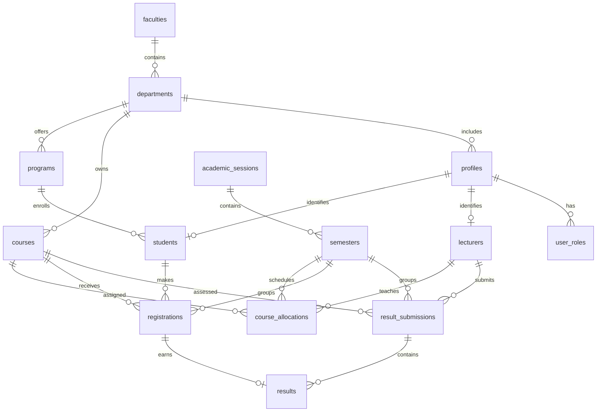

# Unity Portal

A university management MVP built by **Churchil Ogolla**, Senior Software Engineer. It supports students, lecturers, department administrators and super administrators.

## Demo access

Open `/auth`. The sign-in page has quick-fill buttons. All demo users use `Demo@2026!`.

| Role | Email |
| --- | --- |
| Super administrator | `super@uni.demo` |
| Department administrator | `csc.admin@uni.demo` |
| Lecturer | `lecturer@uni.demo` |
| Student | `student@uni.demo` |

Additional sample users are `mth.admin@uni.demo`, `lecturer2@uni.demo` and `student2@uni.demo`.

## Architecture and stack

- **Web app:** React 19, TanStack Start, TanStack Router, Vite, Tailwind CSS and Radix UI components.
- **Hosting:** Vercel server rendering through Nitro.
- **Data and authentication:** Supabase Auth and PostgreSQL.
- **Access control:** pathless role routes require the correct role before loading. PostgreSQL row level security and security definer functions enforce data permissions and workflow rules independently of the UI.
- **Server functions:** account creation and suspension use the server-only Supabase admin client. The service role key must never be exposed through a `VITE_` variable.

## Database design

`audit_logs` records key actions and `grading_scale` holds configurable score bands. The SQL schema is in [`drizzle/migrations/0000_university_core.sql`](drizzle/migrations/0000_university_core.sql), followed by two policy and registration fixes.

## Workflow and security

1. Students select current-term courses. `register_courses()` checks department, program, level, availability and the 24-unit cap. A unique constraint prevents duplicate registrations.
2. Lecturers can save scores only for allocated courses. `save_scores()` prevents edits after submission until an authorized return.
3. Department administrators approve or return submissions through `review_results()`. They are limited to their department and cannot approve their own work.
4. Students see only approved results through the `can_see_result()` policy. Grades and GPA use credit-unit weighting.
5. Role policies and security definer helpers prevent unauthorized reads and policy recursion. `audit_logs` records registration, scoring, review and account actions.

The grading scale is A: 70 to 100 (5 points), B: 60 to 69 (4), C: 50 to 59 (3), D: 45 to 49 (2), E: 40 to 44 (1), F: 0 to 39 (0). CA is out of 40 and the exam is out of 60. GPA is `sum(course units * grade points) / sum(course units)`; CGPA uses all approved results.

## Local setup

1. Use Node.js 22 or newer and run `npm install`.
2. Copy `.env.example` to `.env` and set the Supabase URL, publishable key and server-only service role key. The database schema and policies must already be provisioned in the Supabase project.
3. Run `npm run dev` and open `http://localhost:8080`.
4. Run `npm test`, `npm run lint` and `npm run build` to verify the app.

The connected demo database includes two faculties, three departments, three programs, two academic sessions, ten courses, approved historical results and a pending departmental review. New Supabase projects need this sample data provisioned before the listed demo logins can be used.

## Vercel setup

Import the repository as a TanStack Start project. Add `SUPABASE_URL`, `SUPABASE_PUBLISHABLE_KEY` and `SUPABASE_SERVICE_ROLE_KEY` as server environment variables. Add `VITE_SUPABASE_URL` and `VITE_SUPABASE_PUBLISHABLE_KEY` for the browser. Never add the service role key with a `VITE_` prefix. Deploy using `npm run build`.

## Short demonstration route

1. Student: sign in, register a course, print the registration summary and open Results.
2. Lecturer: open an allocated course, enter CA and exam scores, save and submit.
3. Department administrator: review the submission, approve or return it with feedback.
4. Student: refresh Results to see the approved grade and GPA.
5. Super administrator: open Structure, Sessions, People and Activity to show university-wide oversight.
